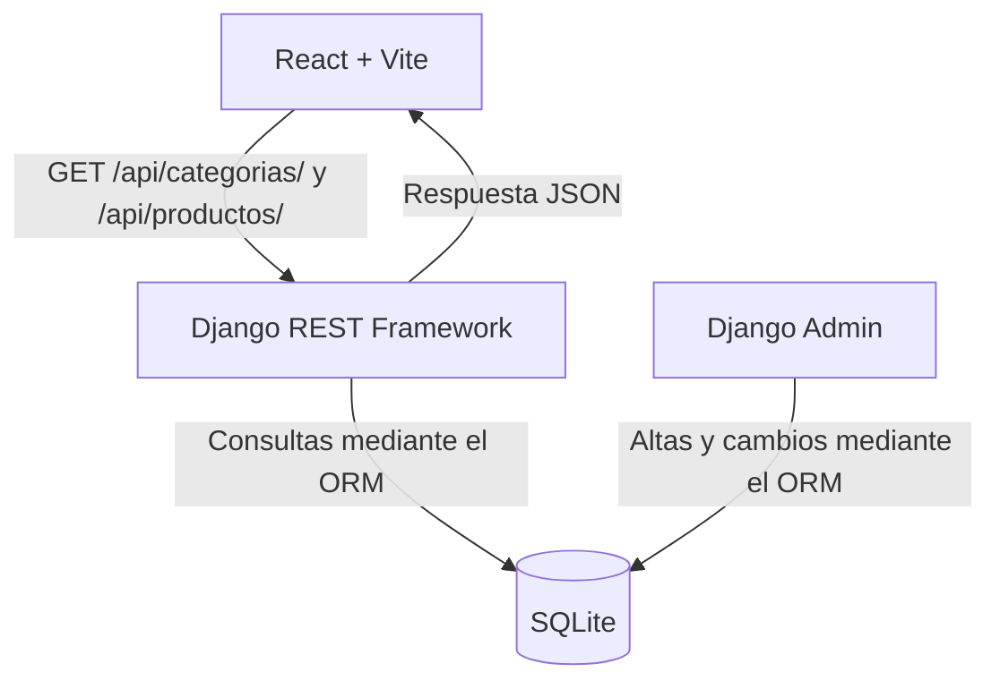

# Dado & Mesa

Catálogo de una tienda de juegos de mesa para el laboratorio de la sesión 14. Incluye juegos de estrategia, cartas y accesorios. Autor: Josué Pérez Herrera.

## 1. Análisis

La primera versión permite consultar categorías y productos, filtrar por categoría, revisar el precio en soles y conocer la cantidad disponible. El personal de la tienda administra categorías y productos en Django Admin.

| Dato del producto | Representación |
| --- | --- |
| Nombre y descripción | Texto corto y texto libre |
| Precio | Decimal con dos posiciones, expresado en soles |
| Imagen | URL HTTP(S) o ruta de una imagen de muestra |
| Disponibilidad | Entero no negativo |
| Categoría | Clave foránea a `Categoria` |

La interfaz tiene un encabezado con logo y navegación, presentación de la tienda, filtro de categorías, cuadrícula de tarjetas y pie de página.



## 2. Iniciar el proyecto

Requisitos: Node.js 20.19+ o 22.12+ y Python 3.10+ (recomendado 3.12).

Abre una terminal PowerShell en la carpeta del proyecto para Django:

```powershell
cd backend
python -m venv .venv
.\.venv\Scripts\python.exe -m pip install -r requirements.txt
.\.venv\Scripts\python.exe manage.py migrate
.\.venv\Scripts\python.exe manage.py loaddata catalogo_demo
.\.venv\Scripts\python.exe manage.py createsuperuser
.\.venv\Scripts\python.exe manage.py runserver 127.0.0.1:8000
```

Carga el fixture solo al inicializar la base de demostración. Repetir la carga repone los valores de los registros de muestra.

Abre otra terminal en la carpeta del proyecto para React:

```powershell
cd frontend
npm.cmd install
npm.cmd run dev -- --host 127.0.0.1
```

| Recurso | Dirección |
| --- | --- |
| Catálogo React | http://127.0.0.1:5173/ |
| Administrador Django | http://127.0.0.1:8000/admin/ |
| Categorías en JSON | http://127.0.0.1:8000/api/categorias/?format=json |
| Productos en JSON | http://127.0.0.1:8000/api/productos/?format=json |

## 3. Componentes

- `frontend/src/pages/Catalogo.jsx` guarda los resultados de la API y la categoría seleccionada. Calcula los productos visibles y maneja carga, error y reintento.
- `frontend/src/components/` contiene `Header`, `CategoryFilter`, `ProductList` y `ProductCard`. `ProductList` convierte los datos de cada producto en propiedades de la tarjeta.
- `frontend/src/components/ui/` contiene versiones adaptadas de `Button` y `Card` de shadcn/ui. Tailwind define la paleta, el espaciado y el número de columnas por ancho.
- `frontend/src/services/catalogo.js` centraliza las consultas HTTP. Vite reenvía `/api` a Django durante el desarrollo y al ejecutar la vista previa de la compilación.

## 4. Modelos y administrador

`backend/catalogo/` contiene modelos, migraciones, administrador, serializadores y vistas REST. Una categoría agrupa varios productos. Django protege las categorías que tienen productos asociados. La API del catálogo ofrece lectura. Los cambios se hacen en el administrador.

Para ingresar un artículo manualmente, abre el administrador, selecciona **Categorías → Añadir** y registra una categoría. En **Productos → Añadir** completa los campos y selecciona esa categoría. La ruta de muestra `/imagenes/dados.png` o una URL HTTP(S) sirven como imagen.

## 5. Comprobar la integración

1. Abre los dos endpoints con `?format=json`. El listado de productos incluye `categoria.id` y `categoria.nombre`.
2. Abre el catálogo y selecciona **Cartas**. Solo deben aparecer **Baraja clásica** y **Fauna andina** con los datos iniciales.
3. En el administrador cambia la cantidad de un producto. Recarga React y comprueba la cantidad nueva. Restablece el valor si estás preparando la entrega.
4. Detén Django y recarga React. Debe aparecer un mensaje de error. Vuelve a iniciar Django y pulsa **Reintentar**.
5. Cambia el ancho de la ventana para comprobar la cuadrícula de una, dos o tres columnas.

## 6. Continuación del comercio electrónico

Las siguientes etapas pueden incorporar carrito, cuentas de clientes, pedidos, pagos y seguimiento de envíos. El catálogo actual proporciona los datos de producto y disponibilidad sobre los que se pueden desarrollar esas funciones.

Documentación técnica: [shadcn/ui con Vite](https://ui.shadcn.com/docs/installation/vite) y [vistas de Django REST Framework](https://www.django-rest-framework.org/api-guide/viewsets/).
